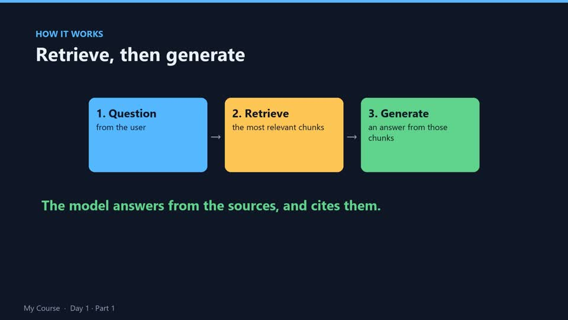
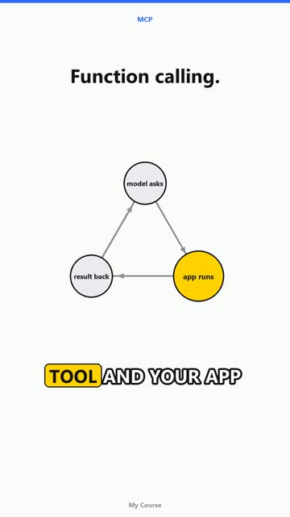
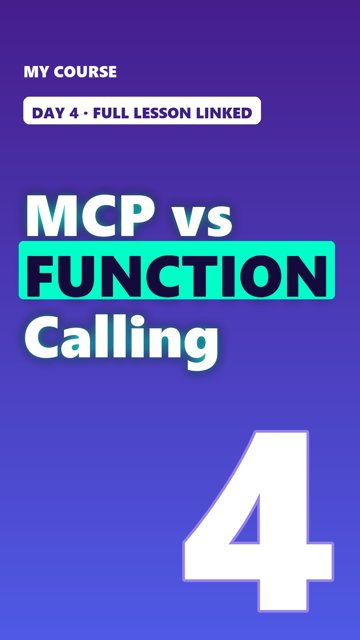
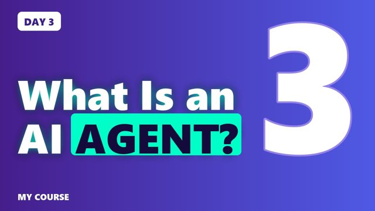
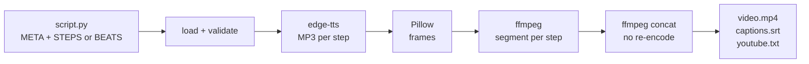

# script-to-video-engine

[](https://github.com/Avinash186200/script-to-video-engine/actions/workflows/ci.yml)  [](LICENSE)

Write a lesson as a short Python script. Get back a narrated 1080p video with captions and YouTube chapters, a
vertical Short with word-by-word karaoke captions, and matching thumbnails.

I built this to produce a 50-episode AI engineering course and its Shorts on my own, without recording or editing
anything by hand: [AI Engineering from Scratch](https://github.com/Avinash186200/ai-engineering-from-scratch)
([YouTube playlist](https://www.youtube.com/playlist?list=PLKRdiVI5CiMg)). Every video on that channel came out of
these engines.

| Slide lesson (16:9) | Short (9:16) | Short cover | Thumbnail |
|---|---|---|---|
|  |  |  |  |

## What problem this solves

Making a teaching video by hand means recording narration, building slides, editing, timing captions and writing
chapters, every time. For a 50-episode course that is weeks of editing. This repo turns a lesson written as plain
Python data into a finished, narrated video with captions and chapters, so changing a lesson means editing text and
rebuilding.

## What you will learn

- How to describe a video as data (a list of narrated steps) and render it with code.
- How to drive a text-to-speech service from Python, including word-level timing.
- How to draw slides and simple animations with Pillow.
- How to use ffmpeg to encode segments and join them without re-encoding.
- How to derive captions and YouTube chapters from measured audio lengths, so they never drift.
- How a fast "check mode" and a banned-word list make a content pipeline safe to run often.

## Key concepts

- **Text-to-speech (TTS):** turns text into spoken audio. Here: edge-tts, a free online service.
- **Word-boundary event:** the TTS service reports when each word starts. Shorts use it to highlight words in time.
- **Karaoke caption:** a caption where the word being spoken is highlighted.
- **SRT:** a plain-text caption file: cue number, start and end time, text.
- **Chapters:** `0:00 Intro`-style lines in a YouTube description that become clickable sections.
- **Segment and concat:** each step is encoded as its own small video, then ffmpeg joins them by copying the data
  (stream copy), which is fast and lossless.
- **Check mode:** a dry run that validates the script and draws one still per step, with no audio and no network.

## What you write

A lesson is a list of steps. Each step is one line of narration and one slide state:

```python
STEPS = [
    {"t": {"tpl": "flow", "kicker": "How it works", "title": "Retrieve, then generate",
           "boxes": [["1. Question", "from the user", "accent"],
                     ["2. Retrieve", "the most relevant chunks", "gold"],
                     ["3. Generate", "an answer from those chunks", "green"]]},
     "say": "RAG fixes that in three steps. Take the question. Retrieve ...",
     "chapter_name": "How RAG works"},
]
```

A Short is four or five beats. Each beat is a headline, a line of narration and a small animated visual:

```python
BEATS = [
    {"headline": "Function calling.",
     "say": "Function calling is how a model asks to use a tool. Your app defines the tool, and your app runs it.",
     "visual": {"type": "loop", "items": ["model asks", "app runs", "result back"]}},
]
```

Full examples: [`examples/lesson_example.py`](examples/lesson_example.py) and [`examples/short_example.py`](examples/short_example.py).

## What you get

| | Slide lesson | Short |
|---|---|---|
| Video | 1920x1080, 30 fps, H.264/AAC | 1080x1920, 30 fps, H.264/AAC |
| Narration | Text-to-speech per step (edge-tts) | Text-to-speech per beat, faster delivery |
| Captions | `captions.srt`, one cue per step | Word-by-word karaoke captions burned in, plus `captions.srt` |
| Metadata | `youtube.txt`: title, description, chapters computed from real audio lengths, tags | `youtube.txt`: title, description, tags |
| Layouts | 16 slide templates: title, section, bullets, two columns, table, code, flow, bars, chat, tokens, callout, steps, roadmap, quiz, recap, end | 5 animated visuals: big number, gauge, versus, loop, thermometer |

## How it works



The full walkthrough, with the exact timings and settings, is in [docs/how-it-works.md](docs/how-it-works.md).

1. **Load and validate.** The script is imported as a module. Every step needs narration and a known template. Any
   word listed in your local `banned_words.txt` (company or employer names, say) fails the build, so nothing
   private slips into a public video.
2. **Narrate.** Each step's text goes to edge-tts. For Shorts the engine also keeps the word-boundary events, so it
   knows the exact start time of every spoken word.
3. **Draw.** Pillow paints each slide. A short build-in animation is rendered frame by frame, then the final frame
   is held for the rest of the narration. Shorts are drawn frame by frame for the whole beat, so the highlighted
   caption word moves exactly with the voice.
4. **Encode.** ffmpeg encodes one segment per step, then joins them without re-encoding. Chapter times come from
   the measured audio lengths, so they always match the video.
5. **Check mode.** `--check` skips audio and writes one still per step, which makes layout problems visible in
   seconds. The tests and CI use it, so they need no network.

## Run it

Needs Python 3.11+ and ffmpeg on your PATH.

```bash
pip install -r requirements.txt

python -m videoengine.slides examples/lesson_example.py --check   # stills only, no audio, no network
python -m videoengine.shorts examples/short_example.py --check    # Short stills, no audio, no network
python -m videoengine.slides examples/lesson_example.py           # output/lesson_example/video.mp4
python -m videoengine.shorts examples/short_example.py            # output/shorts/short_example/video.mp4
python -m videoengine.covers                                      # output/covers/example_cover.jpg
python -m videoengine.thumbnails                                  # output/thumbnails/*.jpg

python -m pytest -q                                               # check-mode tests, no network
```

Check-mode stills go to `output/_check/<id>/` and `output/shorts/_check/<id>/`. A full build needs network access
for the voice. If `video.mp4` already exists, the build prints `skip (built)`; add `--force` to rebuild. On my
machine the example lesson built as a 1.0-minute video (6 steps) and the example Short as 27.8 s (4 beats); both
are example content, not results.

Settings come from environment variables:

| Variable | Default | Meaning |
|---|---|---|
| `VE_SERIES` | `My Course` | Series name in the footer, thumbnails and metadata |
| `VE_REPO_URL` | placeholder | Code link written into lesson descriptions |
| `VE_VOICE` | `en-IN-PrabhatNeural` | Any edge-tts voice, e.g. `en-US-GuyNeural` |
| `VE_FONT_DIR` | auto | Folder with your own fonts (Segoe UI on Windows, DejaVu on Linux, Arial on macOS by default) |

Copy `banned_words.example.txt` to `banned_words.txt` to switch on the private-word check. That file is gitignored.

## Layout

```
videoengine/
    slides.py       slide-lesson engine (templates, narration, encode, chapters)
    shorts.py       Shorts engine (word-timed karaoke captions, animated visuals)
    thumbnails.py   16:9 thumbnails in three styles
    covers.py       9:16 Short covers
    settings.py     series name, voice, fonts, banned words
examples/           lesson_example.py · short_example.py
tests/              test_check_mode.py: check-mode rendering, banned words, covers and thumbnails
docs/               README.md (index) · how-it-works.md (walkthrough) · the four preview images
output/             created by the engines, git-ignored
banned_words.example.txt   copy to banned_words.txt (git-ignored) to switch on the private-word check
.github/            CI workflow
```

## Limits

- edge-tts is a free online service with no guarantees. Swap `synth_words` / `_tts` for another TTS if you need one
  you control.
- Narration speed and slide timing are tuned for teaching. A faster or slower voice may need different
  `ANIM`/`PAD` values in `slides.py`.
- Text that is too long for a template is shrunk or wrapped, not rejected. Run `--check` and look at the stills
  before a full build.

## License

MIT

See [CONTRIBUTING.md](CONTRIBUTING.md) and the [CHANGELOG](CHANGELOG.md).
