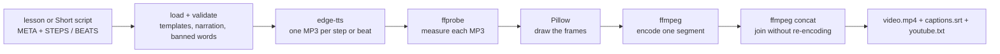

# How it works

These are the method notes for the two engines. The README shows how to run them; this page explains what
happens inside, so you can change a template, swap the voice service or debug a build.

## The idea

A video is a sequence of segments. Each segment is one piece of narration plus the picture that goes with it.
If I know how long each piece of narration lasts, I can draw exactly that many frames, encode the segment, and
join the segments. Nothing is edited by hand, and every timing (captions, chapters, highlighted words) comes from
the measured audio, so it cannot drift.

## Key concepts

- **Text-to-speech (TTS):** turns text into spoken audio. Here it is edge-tts, a free online voice service.
- **Word-boundary event:** a message from the TTS service saying "this word starts at this time". The Shorts
  engine uses it to highlight each word as it is spoken.
- **Karaoke caption:** a caption where the current word is highlighted, moving with the voice.
- **SRT file:** a plain-text caption format: a number, a start and end time, and the text.
- **Chapters:** `0:00 Intro`-style lines in a YouTube description. YouTube turns them into clickable sections.
- **Frame rate:** frames per second. Both engines use 30.
- **H.264 / AAC:** the standard video and audio codecs that YouTube and every player accept.
- **Concat demuxer with stream copy:** ffmpeg joins already-encoded segments by copying their data, without
  decoding and re-encoding. It is fast and loses no quality, but every segment must use the same codec settings.
- **Check mode:** a dry run that validates the script and draws one still per step, with no audio and no network.

## Slide lessons (`videoengine/slides.py`)

A lesson script defines `META` (id, titles, description, tags) and `STEPS`. Each step has `t` (the slide state: a
template name `tpl` plus its fields), `say` (the narration) and optionally `chapter_name`.

1. **Load.** The script is imported as a Python module with `importlib`, so a lesson can use loops and variables to
   build its steps.
2. **Validate.** Every step must name one of the 16 templates (`TEMPLATES` collects every `T_*` function) and have
   non-empty narration. The whole script is lower-cased and searched for every word in `banned_words.txt`; any hit
   stops the build.
3. **Narrate.** Each `say` goes to edge-tts (`_tts`, with up to 4 attempts) and becomes one MP3. `ffprobe` measures
   it, and a pause of 0.45 s (`PAD`) is added.
4. **Draw.** The template is painted with an animation progress value from 0 to 1. The first 0.6 s (`ANIM`) is a
   build-in animation drawn frame by frame. The final frame is saved once as `hold.png`.
5. **Encode a segment.** ffmpeg plays the animation frames, then loops `hold.png` for the rest of the narration,
   and adds the MP3. Output: H.264 at CRF 20, AAC 160 kbps, 48 kHz stereo, 30 fps.
6. **Join.** All segments are listed in a text file and joined with the concat demuxer and `-c copy`.
7. **Captions and chapters.** While looping over steps, the engine keeps a clock. Each step adds one SRT cue from
   its start to the end of its narration. A step starts a chapter when it has a `chapter_name`, or when it uses the
   `section` or `roadmap` template. If the first chapter is not at 0:00, an `Intro` chapter is added, because
   YouTube needs one.
8. **Metadata.** `youtube.txt` gets the title, description, code link (`VE_REPO_URL`), chapters, series line and tags.

A build is skipped if `video.mp4` already exists; pass `--force` to rebuild. `--all --dir <folder>` builds every
lesson in a folder.

## Shorts (`videoengine/shorts.py`)

A Short script defines `META` and `BEATS`. Each beat has a `headline`, a `say` and an optional `visual`
(`bignum`, `gauge`, `versus`, `loop` or `thermometer`).

1. **Validate.** Every beat needs narration, and the banned-word check runs on the whole script, as for lessons.
2. **Narrate with word timing.** `synth_words` asks edge-tts for audio *and* word-boundary events, with a faster,
   higher voice (`rate +14%`, `pitch +20Hz`) that suits the format. It retries up to 5 times and fails if no word
   timings come back.
3. **Draw every frame.** Unlike lessons, a beat is drawn frame by frame for its whole length: headline at the top,
   the animated visual in the middle, and the caption at the bottom. On each frame the engine finds the word whose
   start time has most recently passed and highlights it. Timing is taken from each word's *start*, so the video
   always covers the full audio.
4. **Encode and join.** One encode per beat, an optional outro card (`"outro": False` in `META` turns it off), then
   the same concat-and-copy join.
5. **Outputs.** `output/shorts/<id>/video.mp4` (1080x1920), `captions.srt` with one cue per beat, and `youtube.txt`.

## Thumbnails and covers

`thumbnails.py` draws 1280x720 thumbnails in three styles (`A`, `B`, `C`), each with a short hook, one highlighted
word and a simple visual. `covers.py` draws a 1080x1920 cover for a Short. Run without arguments, both render the
built-in demo set.

## Settings

`settings.py` reads environment variables: `VE_SERIES`, `VE_REPO_URL`, `VE_VOICE` and `VE_FONT_DIR`. The font file
names inside `VE_FONT_DIR` can be changed with `VE_FONT`, `VE_FONT_BOLD`, `VE_FONT_BLACK`, `VE_FONT_MONO` and
`VE_FONT_MONO_BOLD`. `banned_words.txt` is read from the working directory first, then from the repo root.

## Tests

`tests/test_check_mode.py` runs both engines in check mode (6 lesson stills at 1920x1080, 4 Short stills at
1080x1920), checks that a banned word stops a lesson and a Short, and renders the covers and thumbnails. None of it
needs the network or ffmpeg.

## What I would change for a different setup

- **Another TTS service.** Replace `_tts` (lessons) and `synth_words` (Shorts). The Shorts version must return a list
  of `{"text", "start"}` word timings.
- **Another voice speed.** `ANIM` and `PAD` in `slides.py` set the animation length and the pause after each line.
- **New templates.** Add a `T_<name>(ctx, spec, t)` function to `slides.py`. It is picked up automatically.
